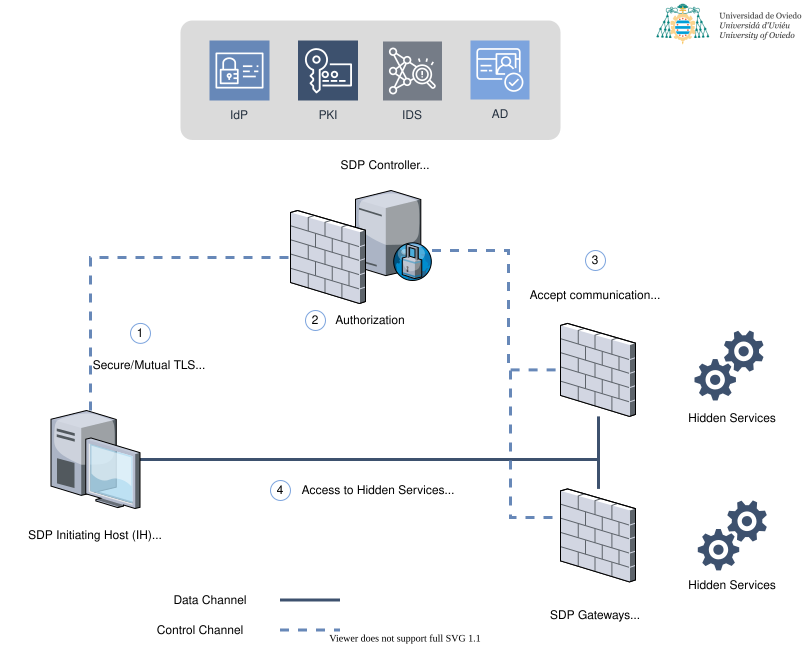
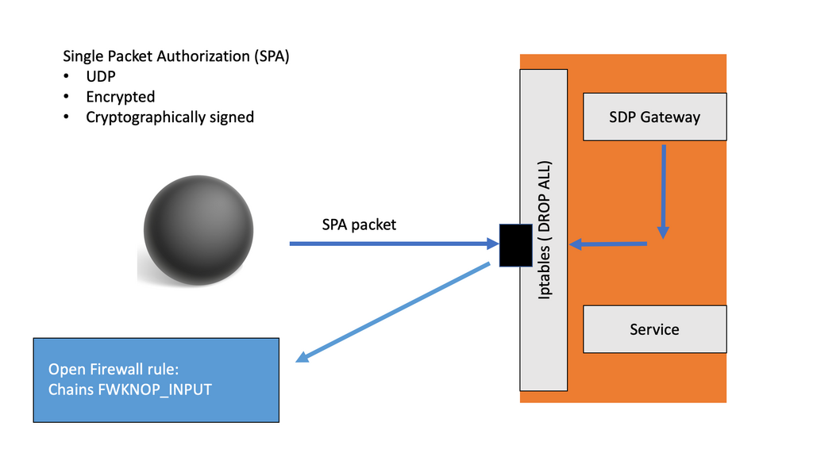

# Software-Defined Perimeter

[](https://doi.org/10.2139/ssrn.4326496)


## Description

Code for the preprint **[Securing the Software-Defined Perimeter Framework with Automated Security Configuration Deployment Systems](https://doi.org/10.2139/ssrn.4326496)** (SSRN, 2023).

This repository deploys a Software-Defined Perimeter (SDP) lab with Docker Compose, based on the open-source implementation by [Waverley Labs](https://www.waverleylabs.com/services/software-defined-perimeter-panther-sdp-implementation/): an SDP Controller, an SDP Gateway that hides a protected service behind a default-drop firewall, and an SDP Client that gains access with Single Packet Authorization (SPA).

The automated security configuration deployment system used in the paper to harden the SDP hosts is **Egida**, maintained in its own repository: [Egida-Kassandra/egida](https://github.com/Egida-Kassandra/egida).

> **Lab use only.** This setup is meant for research and testing. Review the configuration, credentials handling and firewall rules before using any part of it in production.

## Architecture & Components



| Container | Role | Networks |
|---|---|---|
| `sdp-controller` | [Waverley Labs SDP Controller](https://github.com/waverleylabs/SDPController). Runs the PKI: issues certificates and SPA keys for every member, and tells gateways which clients may reach which services. | public, mgmt |
| `sdp-db` | MariaDB with the controller's members, services and permissions. | mgmt (internal) |
| `sdp-gateway` | [fwknop](https://github.com/waverleylabs/fwknop) daemon (SDP fork). Drops all traffic by default; when a valid SPA packet arrives it opens a time-limited DNAT/FORWARD rule for that client only. | public, private |
| `protected-service` | Accepting Host (an nginx web server). Only reachable through the gateway. | private (internal) |
| `sdp-client` | Initiating Host. Sends SPA packets with `fwknop` and refreshes its credentials with the controller. | public |

- **SDP Controller**: authenticates members with mutual TLS (each certificate's CN is the member's SDP ID), rotates their credentials, and pushes service and access lists to the gateways.
- **SDP Gateway**: uses Single Packet Authorization (SPA) for strong service concealment. SPA needs a single packet, encrypted, non-replayable and authenticated with an HMAC, to request access to a service hidden behind a firewall in a default-drop stance.
- **SDP Client (IH)**: requests access to the services the controller allows it to use, without any port being visible beforehand.



## Quick start

Requirements: Docker Engine 26 or newer, with the Compose plugin (`docker compose`).

```bash
cp .env.example .env
# edit .env and replace every "change-me" (e.g. with: openssl rand -base64 24)

docker compose up -d --build --wait
./scripts/demo.sh
```

`scripts/demo.sh` checks the whole flow:

```text
[1/4] Request to http://10.231.0.20:8080/ before SPA (expect: blocked)
  PASS no response, the service is hidden
[2/4] Direct request to the private network (expect: unreachable)
  PASS private network not reachable from the client
[3/4] Sending SPA packet: fwknop -n service_gate
  PASS SPA sent and controller session completed
[4/4] Request to http://10.231.0.20:8080/ after SPA (expect: HTTP 200)
  PASS protected service reachable through the gateway
```

The same steps by hand:

```bash
docker compose exec sdp-client curl -m 4 http://10.231.0.20:8080/   # times out
docker compose exec sdp-client fwknop -n service_gate                # send SPA
docker compose exec sdp-client curl http://10.231.0.20:8080/         # nginx page
```

Access stays open for the time set by the gateway (30 s by default), and only for the client's IP address.

To start from scratch (new CA, keys and database): `docker compose down -v`.

## How it works

1. **Database.** On first start, MariaDB loads the schema (`database/01-schema.sql`) and the example data (`database/02-seed.sh`): gateway (SDP ID 1), controller (SDP ID 2), client (SDP ID 3), and service 1, which maps gateway port `8080/tcp` to `protected-service:80`. The client is allowed to use service 1.
2. **Controller bootstrap** (`controller/entrypoint.sh`). Creates the CA if missing, then runs `genCredentials.js` for each SDP ID that has no keys yet: a TLS certificate and key, plus SPA encryption and HMAC keys stored in the database. It exports one bundle per member into the `bundles` volume. Each container mounts only its own bundle, and the CA private key never leaves the controller.
3. **Gateway** (`gateway/entrypoint.sh`). Sets `INPUT`/`FORWARD` to `DROP`, renders its configuration from the bundle, and starts `fwknopd`. fwknopd connects to the controller, receives the service list and the clients' SPA keys, and sniffs SPA packets on the public interface.
4. **Client** (`client/entrypoint.sh`). Renders `~/.fwknoprc` and `~/sdp_ctrl_client.conf` from its bundle. `fwknop -n service_gate` sends the SPA packet to the gateway, then contacts the controller, which rotates the client's keys and notifies the gateway.

Credentials rotated by the controller are kept in the `gateway-state` and `client-home` volumes, so they survive container restarts and re-creation.

## Configuration

| What | Where |
|---|---|
| Passwords, subnets, IP addresses, protected port | `.env` (see `.env.example`) |
| Members, services and permissions | `database/02-seed.sh` (applied only when the database volume is empty) |
| Controller settings | `controller/config.js` (reads environment variables) |
| Gateway daemon | `gateway/config/fwknopd.conf.tmpl` |
| Gateway / client control-channel settings | `gateway/config/sdp_ctrl_client.conf.tmpl`, `client/config/*.tmpl` |
| Upstream versions | `SDPCONTROLLER_COMMIT` and `FWKNOP_COMMIT` build args in the Dockerfiles |

To inspect the database, start phpMyAdmin (bound to localhost only): `docker compose --profile debug up -d phpmyadmin`, then open <http://127.0.0.1:8081>.

## Troubleshooting

- **`docker compose` asks for variables:** create `.env` from `.env.example`.
- **Subnet overlaps with an existing network:** set `PUBLIC_SUBNET`, `PRIVATE_SUBNET` and the IP variables in `.env`.
- **Gateway logs show iptables permission errors:** the container needs the `NET_ADMIN` and `NET_RAW` capabilities, which `docker-compose.yml` grants. Rootless Docker or restricted hosts may not allow them.
- **Logs:** `docker compose logs -f sdp-gateway sdp-controller`.

## Citation

```bibtex
@misc{paya2023securing,
  title  = {Securing the Software-Defined Perimeter Framework with Automated Security Configuration Deployment Systems},
  author = {Pay{\'a} Gonz{\'a}lez, Antonio and Redondo L{\'o}pez, Jos{\'e} Manuel and Garc{\'i}a D{\'i}az, Vicente and G{\'o}mez G{\'o}mez, Alberto},
  year   = {2023},
  note   = {SSRN preprint},
  doi    = {10.2139/ssrn.4326496}
}
```

## License

[Apache 2.0](LICENSE)
