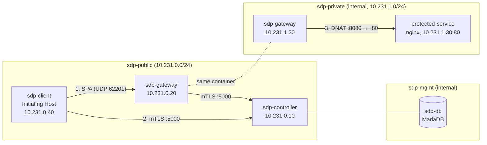
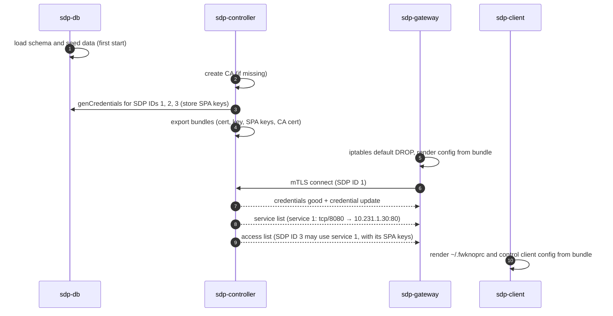
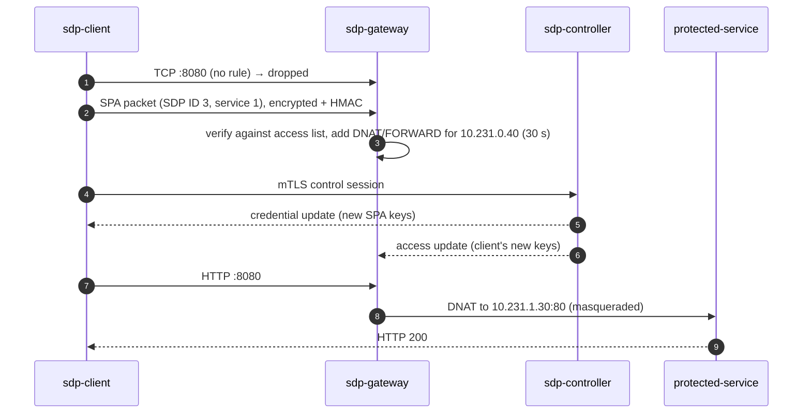

# Architecture

The lab follows the Cloud Security Alliance SDP model: a **controller** decides who may reach what, a **gateway** (Accepting Host side) enforces it, and **clients** (Initiating Hosts) must authenticate before any service is visible to them.

## Networks

| Network | Members | Purpose |
|---|---|---|
| `sdp-public` | client, gateway, controller | The untrusted side. The gateway drops everything here by default. |
| `sdp-private` | gateway, protected service | Internal Docker network: only reachable through the gateway. |
| `sdp-mgmt` | controller, database | Internal Docker network: the database is never exposed. |

## Components

### SDP Controller

The [Waverley Labs SDP Controller](https://github.com/waverleylabs/SDPController) (Node.js), pinned to a fixed commit. It:

- authenticates every member with **mutual TLS**: the CN of each certificate is the member's SDP ID;
- issues and rotates credentials: a TLS certificate plus SPA encryption and HMAC keys;
- sends each gateway its **service list** (which ports to forward where) and its **access list** (which SDP IDs may use which services, with their SPA keys).

On start, `controller/entrypoint.sh` creates the CA if it does not exist yet. It then runs `genCredentials.js` for each SDP ID that has no keys, and exports one credential bundle per gateway and client. Each container mounts only its own bundle, and the CA private key never leaves the controller.

### SDP Gateway

The SDP-enabled [fwknop fork](https://github.com/waverleylabs/fwknop), built from source on Debian 12. The entrypoint sets `INPUT` and `FORWARD` to `DROP` and starts `fwknopd`. fwknopd gets its configuration from the controller and sniffs SPA packets on the public interface. For each valid packet it adds a DNAT and FORWARD rule limited to the client's IP address and the authorized service, and removes them when they expire.

### SDP Client

The fwknop client in SDP mode. `fwknop -n service_gate` sends an encrypted, HMAC-authenticated SPA packet that names the client's SDP ID and the requested service IDs. It then opens a control session with the controller, which rotates the client's keys and notifies the gateway.

## Bootstrap sequence

## Access sequence

## Design choices

- **No secrets in git.** Passwords come from `.env`, and the CA and member credentials are generated at runtime into Docker volumes.
- **Credentials survive restarts.** Keys rotated by the controller are kept in the `gateway-state` and `client-home` volumes.
- **Pinned upstream code.** SDPController and fwknop are cloned at fixed commits, so builds are reproducible.
- **fwknop SNAT disabled.** fwknopd builds its MASQUERADE rule with `--to-ports <gateway port>`. Every forwarded connection would then reuse one source port, and back-to-back connections would collide in conntrack. The gateway adds a plain MASQUERADE rule on the private side instead. Filtering still happens per client in fwknopd's FORWARD rules.
