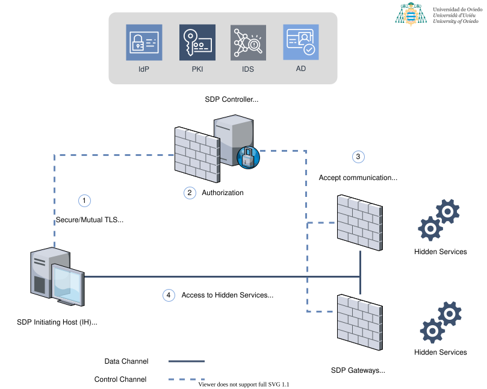

# Software-Defined Perimeter Lab

A reproducible **Software-Defined Perimeter (SDP)** lab built with Docker Compose. A protected web service stays invisible behind a default-drop gateway until a client proves its identity with **Single Packet Authorization (SPA)**; only then does the gateway open a short-lived path for that client alone.

This repository is the companion lab of **SecureSDP** ([International Journal of Information Security, 2024](https://doi.org/10.1007/s10207-024-00863-7)), whose earlier version was published as an [SSRN preprint (2023)](https://doi.org/10.2139/ssrn.4326496). It deploys the open-source SDP from [Waverley Labs](https://github.com/waverleylabs): their SDP Controller and their SDP-enabled fork of [fwknop](https://github.com/mrash/fwknop).

<div class="grid cards" markdown>

- :material-rocket-launch: **[Getting started](getting-started.md)**

    Start the lab with one command and run the end-to-end check.

- :material-sitemap: **[Architecture](architecture.md)**

    Components, networks, and the bootstrap and SPA sequences.

- :material-shield-lock: **[Component hardening](hardening.md)**

    How SecureSDP hardens each component with Egida, and the audit results reported in the paper.

- :material-school: **[Research](research.md)**

    The paper, how to cite it, and the related publications.

</div>

## What you get

{ width="560" }

| Container | Role |
|---|---|
| `sdp-controller` | Runs the PKI, authenticates members with mutual TLS and pushes the service and access lists to the gateways. |
| `sdp-db` | MariaDB holding members, services and permissions. |
| `sdp-gateway` | fwknop daemon in a default-drop firewall. A valid SPA packet opens a time-limited DNAT/FORWARD rule for that client only. |
| `protected-service` | The Accepting Host: an nginx server reachable only through the gateway. |
| `sdp-client` | The Initiating Host: sends SPA packets and refreshes its credentials with the controller. |

```console
$ ./scripts/demo.sh
[1/4] Request to http://10.231.0.20:8080/ before SPA (expect: blocked)
  PASS no response, the service is hidden
[2/4] Direct request to the private network (expect: unreachable)
  PASS private network not reachable from the client
[3/4] Sending SPA packet: fwknop -n service_gate
  PASS SPA sent and controller session completed
[4/4] Request to http://10.231.0.20:8080/ after SPA (expect: HTTP 200)
  PASS protected service reachable through the gateway
```

!!! warning "Lab use only"
    This setup is meant for research, teaching and testing. Review credentials handling, firewall rules and the upstream components (which are no longer actively maintained) before reusing any part of it in production.

## Related projects

- [Secure-SDP](https://antoniopaya22.github.io/Secure-SDP/): Go implementation of the SecureSDP architecture (Bridge model and dynamic hardening).
- [iam-ids-sdp](https://antoniopaya22.github.io/iam-ids-sdp/): SDP with Keycloak IAM and Apollon-based intrusion detection (IJIS 2025).
- [Egida](https://github.com/Egida-Kassandra/egida): the security orchestration tool used for component hardening.

See the [research line](research-line.md) for how they fit together.
